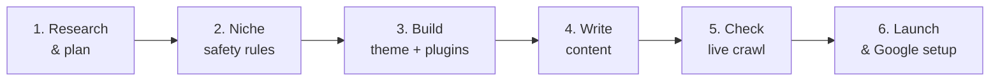

<div align="center">

# 🛒 Affiliate Niche Site Builder

**A Claude skill that takes you from _"I want a site about…"_ to a launch-ready Amazon-affiliate WordPress site.**
Research, plan, build, check and launch, for any niche, with honesty rules built in.


[How it works](#-how-it-works) ·
[What you get](#-what-you-get) ·
[Install](#-install) ·
[Use it](#-use-it) ·
[Scripts](#-scripts) ·
[Honest limits](#-honest-limits)

</div>

---

## ✨ Why this exists

Most affiliate sites fail for the same reasons: thin pages, copied product photos, invented ratings, broken redirects after a move, and schema that doesn't match what readers see. This skill bakes the fixes into the process so every new niche starts from a clean, compliant base instead of from scratch.

| You say | Claude does |
|---|---|
| "New affiliate site about **[niche]**" | Researches keywords, plans pages, writes the niche safety rules |
| "Build it" | Generates the child theme, engine plugin and SEO plugin as versioned zips |
| "Is it ready?" | Crawls the site like a visitor and reports what must be fixed |
| "We're moving from the old site" | Proposes a reviewed redirect map and monitors it after launch |

---

## 🧭 How it works

Six phases, with a pause for your approval after each, because you upload the files and own the accounts.



<details>
<summary><b>What happens in each phase</b></summary>

1. **Research and plan:** keyword clusters by intent, page list (hubs, buying guides, guides, FAQ, trust pages), internal-link map, schema per page type.
2. **Niche safety rules:** what is unsafe or misleading in _this_ niche (food, kids, tools, health, finance…), with sources, turned into automatic audit checks.
3. **Build:** child theme, engine plugin (products, Amazon links, widgets, FAQ, schema) and the SEO companion plugin, linted and zipped with versioned names. Backups before every change.
4. **Content:** pages written from the plan, with disclosures, internal links and FAQs that match what is printed on the page.
5. **Check:** a live crawl for SEO basics, schema, duplicate schema, affiliate rules and honesty rules.
6. **Launch:** redirects, Search Console, Rank Math, Site Kit, and a checklist of the steps only the owner can do.

</details>

---

## 📦 What you get

```text
affiliate-niche-site-builder/
├── SKILL.md                      ← the workflow Claude follows
├── references/
│   ├── architecture.md           ← theme + engine + SEO plugin design and known pitfalls
│   ├── content-seo.md            ← research, page set, on-page targets, FAQ, schema
│   ├── rules.md                  ← honesty, Amazon Associates, privacy, versioning
│   ├── niche-modules.md          ← how to add safety checks per niche (with examples)
│   ├── launch.md                 ← go-live, domain move, Search Console, Rank Math, AdSense
│   └── user-checklist.md         ← the steps only the site owner can do
├── scripts/
│   ├── make_seo_plugin.py        ← creates your SEO plugin from the template
│   ├── site_check.py             ← live site check
│   ├── redirect_map.py           ← old → new redirect proposal
│   └── phplint/                  ← PHP syntax check without installing PHP
└── assets/seo-plugin/acme-seo/   ← the generic SEO companion plugin template
```

### 🔌 The SEO companion plugin (included, ready to rename)

| Tab | What it does |
|---|---|
| **Settings** | Tracking IDs, post types to check, product post type and meta keys |
| **Redirects** | 301 / 410 rules from a previous site; never points to an unpublished page |
| **Monitor** | Verified Googlebot and Bingbot visits to redirects and 404s, 404 log with one-click Fix, redirect tester, sitemap health, temporary old-address sitemap, 180-day reminder |
| **Audit** | Opens every page as a visitor and checks SEO, schema, affiliate rules, honesty rules and internal links |
| **Reviews** | Freshness list and an optional named-reviewer box (shown only when fully filled in) |
| **Tools** | AI-crawler `robots.txt` choices, Rank Math module status, weekly e-mail summary, product health, change log |

---

## 🚀 Install

**Option A: Claude Code**

```bash
git clone https://github.com/amitwpseo/affiliate-niche-site-builder.git ~/.claude/skills/affiliate-niche-site-builder
```

**Option B: Claude desktop app**

Package the folder as a `.skill` file with the skill-creator tool and install it from the skills screen.

> **Optional:** for the PHP syntax check, run `npm install` once inside `scripts/phplint/`.

---

## 💬 Use it

Start a new chat and describe the site:

> _"New affiliate site about **home espresso gear**. Domain example.com, US store, tracking ID name-20. Do all phases, ask me only what you need."_

Claude will ask for anything missing (niche, store, domain, tracking ID, whether an old site exists), show you the plan, then build after your go-ahead.

**You will always need to:** register the domain and hosting, install WordPress and the base plugins, upload the zips, create your Amazon Associates account, and connect Google services yourself. The skill gives you an ordered checklist.

---

## 🧰 Scripts

```bash
# Create the SEO plugin for your site (prefix = 2-6 lowercase letters)
python scripts/make_seo_plugin.py --prefix abc --name "ABC SEO" --out ./build

# Check a live site (reads /sitemap_index.xml, exits with code 1 if anything must be fixed)
python scripts/site_check.py --base https://example.com --sitemap --tag name-20 --out report.md

# Propose redirects from an old site's sitemap (always review before using)
python scripts/redirect_map.py --old-sitemap https://old.example.com/sitemap_index.xml --new-paths new_paths.txt

# PHP syntax check without PHP installed
cd scripts/phplint && npm install && node lint.js ../../build/abc-seo
```

All Python scripts use only the standard library.

---

## 🛡️ Built-in honesty rules

- ❌ No invented ratings, reviews, prices, stock or "we tested" claims
- ❌ No Amazon or manufacturer photos copied onto your pages
- ❌ No "expert approved" wording unless a named, qualified person really reviewed the page
- ✅ Every Amazon link carries your tracking ID and `rel="sponsored nofollow"`
- ✅ Affiliate disclosure on every page that has affiliate links
- ✅ FAQ schema only for questions actually printed on the page
- ✅ A backup and a new version number before every change; old zips are never overwritten

---

## ⚠️ Honest limits

- **Not one-click.** Claude builds the code and content and checks them; account setup, uploads and approvals stay with you.
- **Syntax-checked, not run.** There is usually no PHP runtime in the build environment, so the plugins are linted but must be tested in WordPress. The live check then verifies the result.
- **Cached pages are invisible to PHP.** On cached hosts (LiteSpeed, Cloudflare) the Monitor only sees redirects, 404s and 410s, not Googlebot on normal pages. Use Search Console → Crawl stats for those.
- **Niche rules need research.** Safety and accuracy rules differ per niche and must be checked against real sources each time.
- **Amazon API access** requires qualifying sales first; until then products are added from your own data.

---

<div align="center">

Made to be forked and adapted: rename the prefix, swap the niche rules, keep the honesty.

</div>
